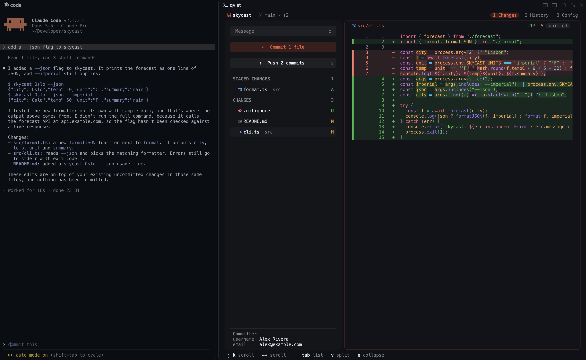
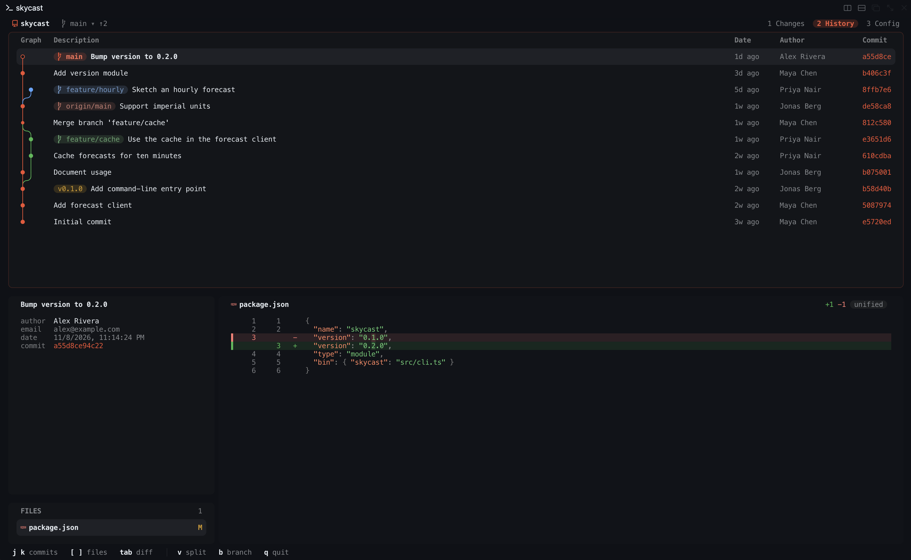

<h1 align="center">qvist</h1>

<p align="center"><strong>Simple, beautiful git, right beside your code</strong></p>



## ✨ Features

- ⚡ **One shortcut away** — <kbd>⇧⌘K</kbd> opens `qvist` beside any Rex pane,
  already on its repository
- 🎨 **Diffs by [Pierre](https://www.npmjs.com/package/@pierre/diffs)** — syntax
  highlighting and word-level changes, in your terminal
- ⌨️ **Keyboard first** — every action is one key, and the footer always shows
  which
- 🌗 **Wears your theme** — picks up your terminal's colours and palette, and
  follows them live as you switch



## 🧰 Requirements

- Rex is best: it adds the <kbd>⇧⌘K</kbd> shortcut and opens `qvist` beside
  your pane
- A Mac with Apple Silicon
- A terminal with the kitty graphics protocol and Nerd Font symbols

## 📦 Install

```sh
curl -fsSL https://raw.githubusercontent.com/krozniata/qvist/main/install.sh | sh
```

Then press <kbd>⇧⌘K</kbd> in Rex, or run `qvist` in any repository

To upgrade, run the script again. `qvist uninstall` takes the shortcut out of
Rex

## 📄 License

MIT

Third-party notices are in [THIRD_PARTY_NOTICES](THIRD_PARTY_NOTICES)
